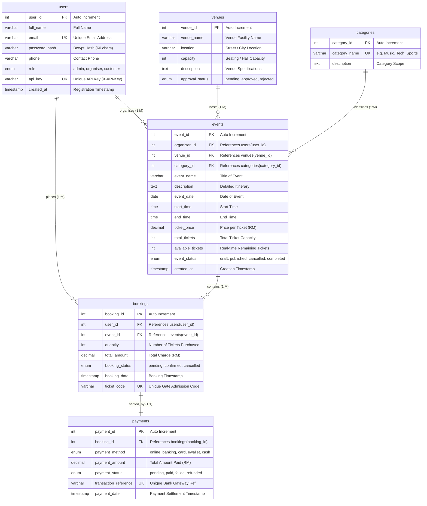

# Entity Relationship Diagram (ERD) & Database Specification
**Course**: SWC3633 / SWC4443 Web API Development  
**System**: Event Ticketing and Venue Booking System  
**Institution**: Universiti Poly-Tech Malaysia (UPTM)  
**Database**: `event_ticketing_db` (MySQL / MariaDB)

---

## 1. Visual Entity Relationship Diagram (Mermaid)

---

## 2. Relational Schema Data Dictionary

### 2.1 Table: `users`
| Column Name | Data Type | Constraints | Description |
|---|---|---|---|
| `user_id` | `INT` | `PRIMARY KEY`, `AUTO_INCREMENT` | Unique user identifier |
| `full_name` | `VARCHAR(100)` | `NOT NULL` | User full name |
| `email` | `VARCHAR(150)` | `NOT NULL`, `UNIQUE` | User email address used for login |
| `password_hash` | `VARCHAR(255)` | `NOT NULL` | Secure bcrypt hashed password |
| `phone` | `VARCHAR(20)` | `NULL` | Contact phone number |
| `role` | `ENUM` | `NOT NULL`, Default: `'customer'` | Role: `'admin'`, `'organiser'`, `'customer'` |
| `api_key` | `VARCHAR(100)` | `UNIQUE`, `NULL` | Cryptographically random API Key (`X-API-Key`) |
| `created_at` | `TIMESTAMP` | Default: `CURRENT_TIMESTAMP` | Account registration timestamp |

### 2.2 Table: `venues`
| Column Name | Data Type | Constraints | Description |
|---|---|---|---|
| `venue_id` | `INT` | `PRIMARY KEY`, `AUTO_INCREMENT` | Unique venue identifier |
| `venue_name` | `VARCHAR(150)` | `NOT NULL` | Facility name (e.g. KL Convention Centre) |
| `location` | `VARCHAR(255)` | `NOT NULL` | City / Address |
| `capacity` | `INT` | `NOT NULL` | Max attendance capacity |
| `description` | `TEXT` | `NULL` | Facility details and amenities |
| `approval_status` | `ENUM` | `NOT NULL`, Default: `'pending'` | Admin review: `'pending'`, `'approved'`, `'rejected'` |

### 2.3 Table: `categories`
| Column Name | Data Type | Constraints | Description |
|---|---|---|---|
| `category_id` | `INT` | `PRIMARY KEY`, `AUTO_INCREMENT` | Unique category identifier |
| `category_name` | `VARCHAR(100)` | `NOT NULL`, `UNIQUE` | Category name (Music, Tech, Sports, etc.) |
| `description` | `TEXT` | `NULL` | Scope of category |

### 2.4 Table: `events`
| Column Name | Data Type | Constraints | Description |
|---|---|---|---|
| `event_id` | `INT` | `PRIMARY KEY`, `AUTO_INCREMENT` | Unique event identifier |
| `organiser_id` | `INT` | `FOREIGN KEY (users.user_id)` `ON DELETE CASCADE` | Organiser user hosting event |
| `venue_id` | `INT` | `FOREIGN KEY (venues.venue_id)` `ON DELETE RESTRICT` | Scheduled venue |
| `category_id` | `INT` | `FOREIGN KEY (categories.category_id)` `ON DELETE RESTRICT` | Classification |
| `event_name` | `VARCHAR(150)` | `NOT NULL` | Event title |
| `description` | `TEXT` | `NULL` | Summary & agenda |
| `event_date` | `DATE` | `NOT NULL` | Date of event (`YYYY-MM-DD`) |
| `start_time` | `TIME` | `NOT NULL` | Event starting time (`HH:MM:SS`) |
| `end_time` | `TIME` | `NOT NULL` | Event finishing time (`HH:MM:SS`) |
| `ticket_price` | `DECIMAL(10,2)`| `NOT NULL` | Unit ticket cost in Ringgit Malaysia (RM) |
| `total_tickets` | `INT` | `NOT NULL` | Total inventory |
| `available_tickets` | `INT` | `NOT NULL` | Available tickets for sale |
| `event_status` | `ENUM` | `NOT NULL`, Default: `'draft'` | `'draft'`, `'published'`, `'cancelled'`, `'completed'` |
| `created_at` | `TIMESTAMP` | Default: `CURRENT_TIMESTAMP` | Timestamp of event creation |

### 2.5 Table: `bookings`
| Column Name | Data Type | Constraints | Description |
|---|---|---|---|
| `booking_id` | `INT` | `PRIMARY KEY`, `AUTO_INCREMENT` | Unique booking identifier |
| `user_id` | `INT` | `FOREIGN KEY (users.user_id)` `ON DELETE CASCADE` | Purchasing customer |
| `event_id` | `INT` | `FOREIGN KEY (events.event_id)` `ON DELETE CASCADE` | Booked event |
| `quantity` | `INT` | `NOT NULL` | Ticket count |
| `total_amount` | `DECIMAL(10,2)`| `NOT NULL` | Total cost in RM (`quantity * ticket_price`) |
| `booking_status` | `ENUM` | `NOT NULL`, Default: `'pending'` | `'pending'`, `'confirmed'`, `'cancelled'` |
| `booking_date` | `TIMESTAMP` | Default: `CURRENT_TIMESTAMP` | Time of reservation |
| `ticket_code` | `VARCHAR(100)` | `UNIQUE`, `NULL` | Unique code used for admission QR scanning |

### 2.6 Table: `payments`
| Column Name | Data Type | Constraints | Description |
|---|---|---|---|
| `payment_id` | `INT` | `PRIMARY KEY`, `AUTO_INCREMENT` | Unique transaction ID |
| `booking_id` | `INT` | `FOREIGN KEY (bookings.booking_id)` `ON DELETE CASCADE` | Linked booking record |
| `payment_method` | `ENUM` | `NOT NULL` | `'online_banking'`, `'card'`, `'ewallet'`, `'cash'` |
| `payment_amount` | `DECIMAL(10,2)`| `NOT NULL` | Paid amount in RM |
| `payment_status` | `ENUM` | `NOT NULL`, Default: `'pending'` | `'pending'`, `'paid'`, `'failed'`, `'refunded'` |
| `transaction_reference` | `VARCHAR(100)` | `UNIQUE`, `NULL` | Payment gateway reference identifier |
| `payment_date` | `TIMESTAMP` | Default: `CURRENT_TIMESTAMP` | Payment timestamp |

---

## 3. Referential Integrity & Business Rules
1. **Cascade Delete for Users**: Deleting a customer cascades to their bookings. Deleting an organiser cascades to their events.
2. **Restrict Venue & Category Delete**: Venues or Categories linked to active events cannot be dropped (`ON DELETE RESTRICT`), preventing orphan event records.
3. **Inventory Management**: When a booking is created, `available_tickets` in `events` decrements by `quantity`. When a booking is cancelled, `available_tickets` is refunded back.
4. **Gate Admission**: Each confirmed booking generates a unique cryptographic `ticket_code` embedded into the external QR Code and PDF ticket, verified at `/api/bookings/verify-ticket`.
